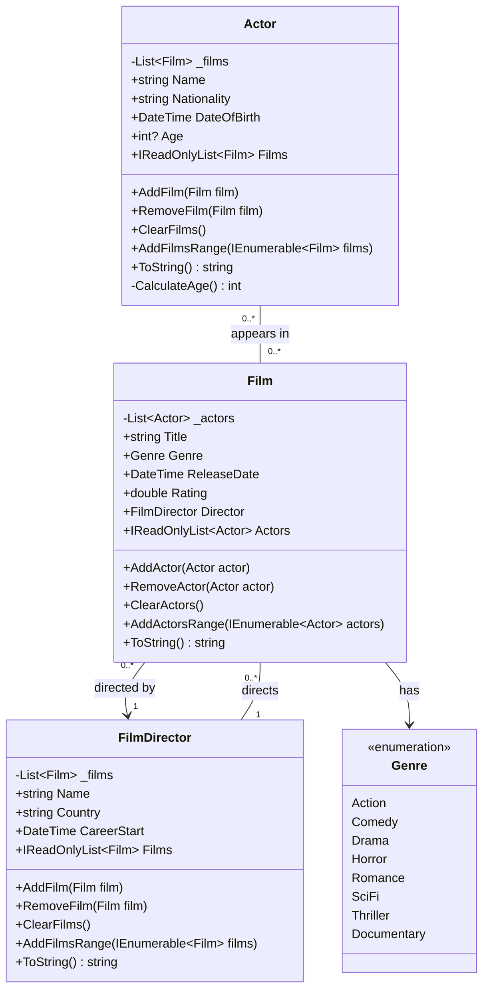
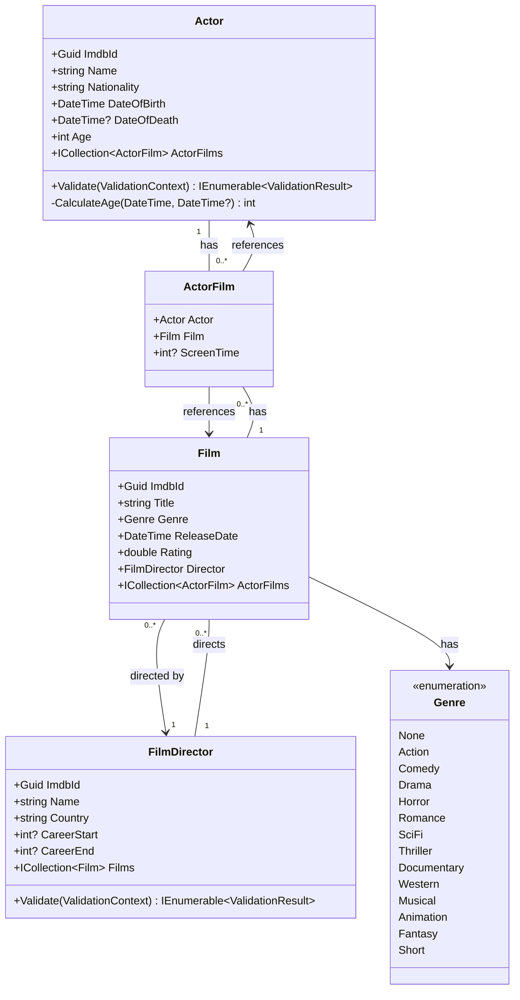
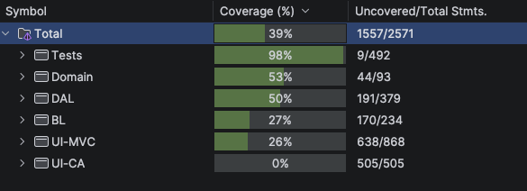

# Film Database - Project .NET Framework

* Naam: Romeo Weyns
* Academiejaar: 25-26
* Klasgroep: INF-202A
* Onderwerp: Film, Actor, FilmDirector

## Sprint 1 

### UML Class Diagram



## Sprint 3

### Beide zoekcriteria ingevuld

```sql
SELECT "a"."ImdbId", "a"."DateOfBirth", "a"."DateOfDeath", "a"."Name", "a"."Nationality"
FROM "Actors" AS "a"
WHERE instr(upper("a"."Name"), @__upperFilter_0) > 0 AND "a"."DateOfBirth" <= @__maxDateOfBirth_1
-- Name = "Emma" AND MinimumAge = 20
```

### Enkel zoeken op naam

```sql
SELECT "a"."ImdbId", "a"."DateOfBirth", "a"."DateOfDeath", "a"."Name", "a"."Nationality"
FROM "Actors" AS "a"
WHERE instr(upper("a"."Name"), @__upperFilter_0) > 0
-- Name = "Emma"
```

### Enkel zoeken op minimum leeftijd

```sql
SELECT "a"."ImdbId", "a"."DateOfBirth", "a"."DateOfDeath", "a"."Name", "a"."Nationality"
FROM "Actors" AS "a"
WHERE "a"."DateOfBirth" <= @__maxDateOfBirth_0
-- MinimumAge = 20
```

### Beide zoekcriteria leeg

```sql
SELECT "a"."ImdbId", "a"."DateOfBirth", "a"."DateOfDeath", "a"."Name", "a"."Nationality"
FROM "Actors" AS "a"
```

## Sprint 4



## Sprint 6

### New Director

#### Request

```http
POST http://localhost:5199/api/directors
Accept: application/json
Content-Type: application/json

{
  "name": "Romeo Weyns",
  "country": "Belgium",
  "careerStart": 1995,
  "careerEnd": null
}
```

#### Response

```http
HTTP/1.1 201 Created
Content-Type: application/json; charset=utf-8
Date: Wed, 24 Dec 2025 19:43:07 GMT
Server: Kestrel
Location: http://localhost:5199/api/Directors/04d45648-c449-4727-9314-938cbf8e8c6f
Transfer-Encoding: chunked

{
  "imdbId": "04d45648-c449-4727-9314-938cbf8e8c6f",
  "name": "Romeo Weyns",
  "country": "Belgium",
  "careerStart": 1995,
  "careerEnd": null
}
```

## Sprint 7

### Users, passwords and roles

| Username | Password | Role |
|---|---|---|
| admin@test.tld | Admin@123$ | Admin |
| test1@test.tld | Test1@123$ | User |
| test2@test.tld | Test2@123$ | User |
| test3@test.tld | Test3@123$ | User |
| test4@test.tld | Test4@123$ | User |

---

### API request 1 — POST director (not logged in)
```http
POST http://localhost:5199/api/directors
Accept: application/json
Content-Type: application/json

{
  "name": "Unauthorized Director",
  "country": "Belgium",
  "careerStart": 2000,
  "careerEnd": null
}
```

```http
HTTP/1.1 401 Unauthorized
Content-Length: 0
Date: Sat, 28 Feb 2026 17:35:54 GMT
Server: Kestrel
```

---

### API request 2 — POST director (logged in as admin)

```http
# @no-cookie-jar
POST http://localhost:5199/api/directors
Accept: application/json
Content-Type: application/json
Cookie: .AspNetCore.Identity.Application=CfDJ8EAsO7fHPgNKhOj3GREElwE7L2pFIQs3yn4J9QYpVqHwR9sokd-xbdWrcLmXfXUQRPXbnaA2kR6QSdQpNzry-IvboRV7sBP8I4cH-i8Qjm_XZrnFzPbbLVNbwUMOn576ohPWFOYru-ulpRiGtaXY5XdypmzJxeA1PMcADbe2pC2JN9PRP4RqD2NVh7l1cmuoDhiIzMNaAmx1Cd-kR3ISc-pZRsD-aAG_8QWkMmKObH7maGhNY8ApaJuqKkwx2NQ8WVsRRW409SZQKvjPvmhI8-vhZbAA4e5LmKfmspc9_yTkrytSHB1ekDZqrIu8wm6Htp6GJbNC-MHRXr0R7C6Ei19SLT6e_aEIGMsRN3wUwpazIaY28RVG89CFL8MY4q5BUVeP8CnlP3Z2TAtxKcLnPbG5rsPgriqP9fv-btv9ioL9qg19gGTGGjJsg_56BGrbdZ0IYaWYDvdN04g1d4tYG6LCmAFDPkKFYIL1JrliKLDg3c0p6B3hV1mTShh7leUnmBjx8mEltZ73koxLwQO2dcqR5DQH1LGwaysDCw-Tfb8FYCTNgyY_f6vNCc5vqnlp7EzHV03hM5Up1sCCT-ulDJBwMJbxlxJfbzAFD-EYA7PYKDfKAn7HeZvvafPfTfXEszY0oEaewiyuTy4E-28UDjtEOd6Gu1QT_AcJEM789yT026No9azQTsX0h0DOo1GXPUDcyWH9BuKyzdlc8PO2HzEmiQIxNlfqeyGTDkM-pynPhA9wzpk6eL-qtqEcWmAOeaNXVJGqAQAuw_HtQVUc4FQGQJ5PyM_NCxJlrdVqs8AGRt0yJVONKJcxPInF5sPKyhLcLP5444EemN7s5xOgxgM

{
  "name": "Authenticated Director",
  "country": "Belgium",
  "careerStart": 2000,
  "careerEnd": null
}
```

```http
HTTP/1.1 201 Created
Content-Type: application/json; charset=utf-8
Date: Sat, 28 Feb 2026 17:35:55 GMT
Server: Kestrel
Location: http://localhost:5199/api/Directors/d2893e87-fde9-4ef9-af6c-d8fd91f80d9c
Transfer-Encoding: chunked

{
  "imdbId": "d2893e87-fde9-4ef9-af6c-d8fd91f80d9c",
  "name": "Authenticated Director",
  "country": "Belgium",
  "careerStart": 2000,
  "careerEnd": null
}
```

---

## Sprint 8

### Running the tests

```shell
dotnet test
```

### Code coverage

Run tests with code coverage and generate an HTML report:

```shell
dotnet test --collect:"XPlat Code Coverage" -- DataCollectionRunSettings.DataCollectors.DataCollector.Configuration.Format=cobertura
reportgenerator -reports:"**/coverage.cobertura.xml" -targetdir:"coveragereport" -reporttypes:Html
```



### Complex authorization requirements

The complex authorization requirements (role-based + ownership logic) are tested in:

`FilmManagement.UI.MVC.Tests.IntegrationTests.FilmsApiControllerTests`

This class covers the custom `film.Maintainer?.Id == currentUser?.Id || isAdmin` logic on the
`UpdateRating` and `Delete` endpoints, verifying 401, 403, maintainer access, and admin override.

### Verification (mock)

Mock verification (`Verify` / `VerifyAll`) is used in:

`FilmManagement.UI.MVC.Tests.UnitTests.FilmManagerUnitTests`

Every test in this class asserts whether `IRepository` methods were or were not called,
using `.Verifiable(Times.Never)` and `.Verifiable(Times.Exactly(1))` followed by `_mock.VerifyAll()`.

### Pipeline — Tests tab

[View passing pipeline Tests tab](https://gitlab.com/kdg-ti/programmeren-2-dotnet/25-26/inf202/projects/romeo.weyns/-/pipelines/2396490617/test_report?job_name=tests)

### Pipeline — Code coverage report

[View code coverage report](https://gitlab.com/kdg-ti/programmeren-2-dotnet/25-26/inf202/projects/romeo.weyns/-/jobs/13568863539/artifacts/browse/Tests/TestResults/CoverageReport/)
