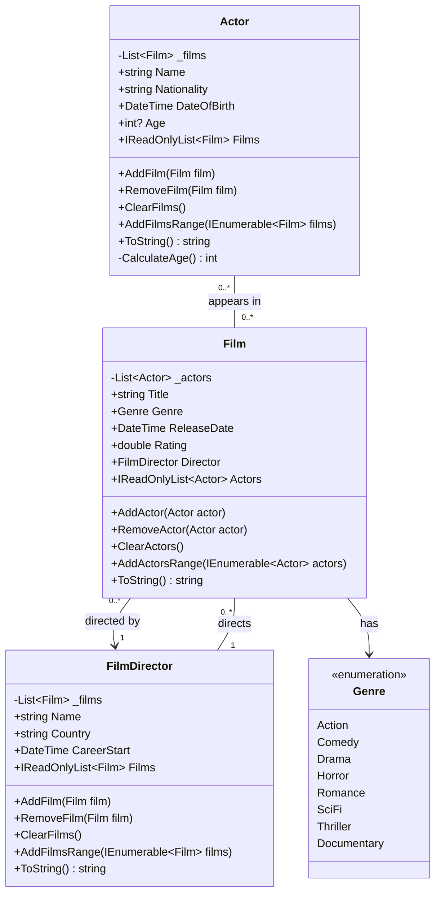
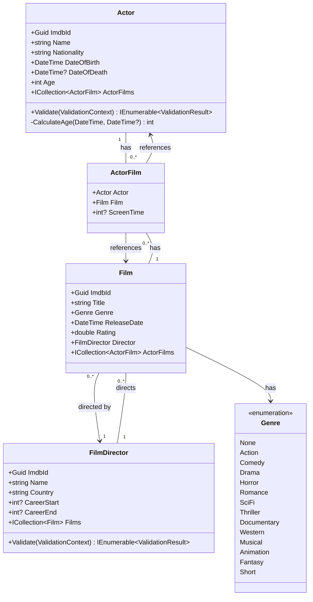

# Film Database - Project .NET Framework

* Naam: Romeo Weyns
* Studentennummer: 0177605-95
* Academiejaar: 25-26
* Klasgroep: INF-202A
* Onderwerp: Film, Actor, FilmDirector

## Sprint 1 

### UML Class Diagram



## Sprint 3

### Beide zoekcriteria ingevuld

```sql
SELECT "a"."ImdbId", "a"."DateOfBirth", "a"."DateOfDeath", "a"."Name", "a"."Nationality"
FROM "Actors" AS "a"
WHERE instr(upper("a"."Name"), @__upperFilter_0) > 0 AND "a"."DateOfBirth" <= @__maxDateOfBirth_1
-- Name = "Emma" AND MinimumAge = 20
```

### Enkel zoeken op naam

```sql
SELECT "a"."ImdbId", "a"."DateOfBirth", "a"."DateOfDeath", "a"."Name", "a"."Nationality"
FROM "Actors" AS "a"
WHERE instr(upper("a"."Name"), @__upperFilter_0) > 0
-- Name = "Emma"
```

### Enkel zoeken op minimum leeftijd

```sql
SELECT "a"."ImdbId", "a"."DateOfBirth", "a"."DateOfDeath", "a"."Name", "a"."Nationality"
FROM "Actors" AS "a"
WHERE "a"."DateOfBirth" <= @__maxDateOfBirth_0
-- MinimumAge = 20
```

### Beide zoekcriteria leeg

```sql
SELECT "a"."ImdbId", "a"."DateOfBirth", "a"."DateOfDeath", "a"."Name", "a"."Nationality"
FROM "Actors" AS "a"
```

## Sprint 4



## Sprint 6

### New Director

#### Request

```http
POST http://localhost:5199/api/directors
Accept: application/json
Content-Type: application/json

{
  "name": "Romeo Weyns",
  "country": "Belgium",
  "careerStart": 1995,
  "careerEnd": null
}
```

#### Response

```http
HTTP/1.1 201 Created
Content-Type: application/json; charset=utf-8
Date: Wed, 24 Dec 2025 19:43:07 GMT
Server: Kestrel
Location: http://localhost:5199/api/Directors/04d45648-c449-4727-9314-938cbf8e8c6f
Transfer-Encoding: chunked

{
  "imdbId": "04d45648-c449-4727-9314-938cbf8e8c6f",
  "name": "Romeo Weyns",
  "country": "Belgium",
  "careerStart": 1995,
  "careerEnd": null
}
```
---